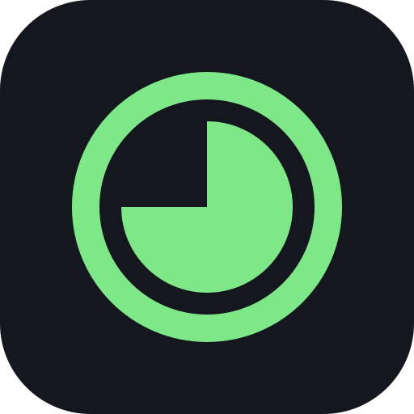
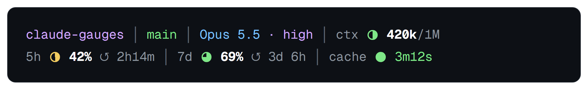
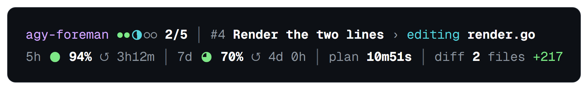

# claude-gauges

A fast status line for the Claude Code CLI, written in Go. It shows your usage limits, context window and prompt cache as small gauges, so you can see at a glance how much room you have left.

[](https://github.com/mountaser/claude-gauges/actions/workflows/ci.yml)
[](LICENSE)




_The two lines under your prompt in Claude Code: project and branch, model and effort, context, both usage limits with their reset times, and the prompt cache timer._

## Why claude-gauges

Most status lines for Claude Code are shell, Python or Node scripts. Claude Code runs the status line again on every refresh, once a second by default, so what it costs to start matters. claude-gauges is one compiled Go program:

- **Fast.** A full render takes 32 ms on my Windows PC, including launching the process. A bare Python start takes 112 ms and a bare Node start 43 ms, before they run any code of their own (average of ten runs).
- **Nothing to install first.** It is a single file. Shell scripts need `jq` and a Unix shell, so on Windows they need Git Bash or WSL. Python and Node versions need an interpreter, and often a package manager, on your PATH.
- **No other processes.** It reads the git branch from `.git/HEAD` and parses the JSON itself, so it never starts `git` or `jq`. A script usually starts several processes on every refresh.
- **One code base for every system.** The same source builds for Windows, macOS and Linux, and its rendering is covered by tests that use fixed times.

And it puts more of what matters in a long session on one screen:

- Both usage limits, drawn as pies that empty, with a countdown to each reset.
- The effort level right next to the model name.
- Context as tokens used out of the real window size (`420k/1M`, `120k/200k`).
- The prompt cache countdown and, once it has expired, how many tokens the next message will have to re-read.
- Optional lines that follow your [agy-foreman](https://github.com/mountaser/agy-foreman) jobs.

What you give up: a change to the code needs a rebuild, the program is about 3 MB instead of a few kilobytes of script, and an unsigned download can make Windows SmartScreen or macOS Gatekeeper ask for confirmation. The installer downloads checksummed releases to keep that safe.

## Install

**macOS, Linux, WSL**

```bash
curl -fsSL https://raw.githubusercontent.com/mountaser/claude-gauges/main/install.sh | bash
```

**Windows PowerShell**

```powershell
irm https://raw.githubusercontent.com/mountaser/claude-gauges/main/install.ps1 | iex
```

Then restart Claude Code.

The installer downloads the program for your system, checks its checksum, copies it to `~/.claude/` and sets `statusLine` in `~/.claude/settings.json`. Your other settings are kept and the old file is saved as `settings.json.bak`.

**Manual install:** download the file for your system from the [releases page](https://github.com/mountaser/claude-gauges/releases), then run `claude-gauges install`.

**Update:** run the install command again.

**Uninstall:** run `claude-gauges uninstall`. It puts your previous status line back.

If you already have a status line, `install` stops and tells you. Run `claude-gauges install --force` to replace it; the old one is saved and `uninstall` restores it.

## What the gauges mean

| Segment | Shows |
|---|---|
| `screentether │ main` | Project folder and git branch. In a git worktree, the main repository's name and the worktree folder. |
| `Opus 5.5 · high` | The model and the effort level that is set. |
| `ctx ◑ 420k/1M` | Tokens in the context window out of its size. It fills as the conversation grows. |
| `5h ◑ 42% ↺ 2h14m` | How much of your 5-hour limit is left, and when it resets. |
| `7d ◕ 69% ↺ 3d 6h` | The same for your weekly limit. |
| `cache ● 3m12s` | Time until the prompt cache expires. Each message you send resets it. |
| `▲ cold · +461k tokens to reload` | The cache has expired. The next message re-reads the conversation, about this many tokens. |

The pie shows how full something is, in quarters: `○ ◔ ◑ ◕ ●`. For the limits it is what is left, so it empties as you use them. For `ctx` it is what is used, so it fills.

Colors:
- **Limits:** green above 50% left, yellow from 20% to 50%, red below 20%.
- **Context:** green under half, yellow from half, red from 80%.
- **Cache:** green while warm, yellow in the last minute, orange when cold.

**The limits are the other way round from Claude Code.** Claude Code's `/usage` and the data it sends to status lines report how much you have used. claude-gauges shows how much is left, so `5h ◑ 42%` means 42% of the 5-hour limit remains and 58% is used. The pie empties as you spend it, like a fuel gauge.

A value that is not available yet shows `–`. Limits and cache data arrive after your first reply in a session.

## Delegation lines (agy-foreman)

If you use [agy-foreman](https://github.com/mountaser/agy-foreman) to hand plan tasks to Gemini, two more lines appear while jobs run:



The first line is the plan's tasks (green done, spinning running, red failed, dim waiting) and what Gemini is doing now. The second is your Gemini limits, the plan's running time and what it has changed so far. The lines disappear when no job is active.

claude-gauges only reads the file agy-foreman writes (`status.json` in its state folder). Without agy-foreman nothing changes.

## Requirements

- **Claude Code 2.1.251 or newer** for the cache timer. Older versions show `cache –`.
- **A Pro or Max plan** for the 5-hour and weekly limits. Other plans show `–`.
- **A terminal with true color and a font that has the Geometric Shapes block** (Windows Terminal, iTerm2, most modern terminals). If the pies show as empty boxes, change the terminal font.

## Settings

| Setting | Effect |
|---|---|
| `NO_COLOR=1` | No colors. |
| `COLUMNS=<n>` | Terminal width. When set, the delegation lines are shortened to fit. Claude Code may not set it for you. |
| `FOREMAN_STATE_DIR=<path>` | Where to look for agy-foreman's `status.json`. |
| `claude-gauges install --refresh <seconds>` | How often Claude Code refreshes the line. Default 1. |
| `claude-gauges install --settings <path>`, `--dest <folder>` | Use another settings file or install folder. |

## How it works

Claude Code runs the program every refresh and sends the session as JSON on standard input: model, effort, context size, limits and cache. The program prints the lines and exits. The git branch is read straight from `.git/HEAD`. The delegation lines come from agy-foreman's `status.json`, and are shown only when that file is fresh (updated in the last 15 seconds).

## Troubleshooting

- **Nothing changed after installing.** Restart Claude Code, then check that `statusLine` in `~/.claude/settings.json` points at `claude-gauges`.
- **Boxes instead of circles.** Your terminal font lacks the shapes. Switch to a font that has them, such as Cascadia Mono or JetBrains Mono.
- **Limits show `–`.** They appear after the first reply, and only on Pro and Max plans.
- **Install says a status line already exists.** Use `--force`; your old one is saved and `uninstall` restores it.

## Build from source

Requires Go 1.22 or newer.

```bash
go test ./...
go build -ldflags "-s -w -X main.version=0.2.1" -o claude-gauges .
```

Cross-compile with `GOOS` and `GOARCH`, for example `GOOS=linux GOARCH=arm64 go build -o claude-gauges .`

## License

MIT. Copyright (c) 2026 Mountaser Halak. See `LICENSE` for the full text and `NOTICE.md` for third-party notices.
